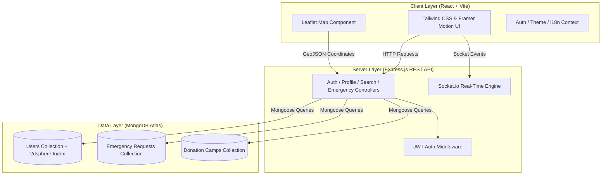

# 🩸 BloodOcean

<p align="center">
  
</p>

<h3 align="center">Lifesaving Emergency Blood Donation & Real-Time Geolocation Platform</h3>

<p align="center">
  <b>Connecting emergency blood seekers with verified nearby donors in real-time.</b>
</p>

<p align="center">
  <a href="https://bloodocean.vercel.app"></a>
  
  
  
  
</p>

---

## 📌 Links & Resources

- 🌐 **Live Web Application:** [https://bloodocean.vercel.app](https://bloodocean.vercel.app)
- 📖 **API Documentation:** [API_DOCUMENTATION.md](./API_DOCUMENTATION.md)
- 🚀 **Deployment Guide:** [DEPLOYMENT.md](./DEPLOYMENT.md)
- 📋 **Project Context & Architecture:** [PROJECT_CONTEXT.md](./PROJECT_CONTEXT.md)

---

## 📖 Overview

**BloodOcean** is a full-stack, responsive web application engineered to bridge the critical gap between blood donors and patients requiring emergency blood transfusions. By utilizing high-precision geospatial indexing (`2dsphere` on MongoDB Atlas) and the native browser Geolocation API, BloodOcean enables real-time proximity-based donor matching, emergency request broadcasting, interactive map navigation, live tracking, and blood camp management.

---

## ✨ Key Features

### 📍 Proximity-Based Donor Search
- **Haversine Proximity Search:** Find compatible donors within configurable radii (5 km, 10 km, 20 km, 50 km).
- **Geospatial Indexing:** Driven by MongoDB `GeoJSON Point` data and `$nearSphere` queries for ultra-fast location matching.
- **Filter by Compatibility:** Instant filtering by exact blood group compatibility (`A+`, `A-`, `B+`, `B-`, `AB+`, `AB-`, `O+`, `O-`) and availability status.

### 🚨 Emergency Request Broadcast
- **Create Urgent Requests:** Post emergency blood requirements with patient details, hospital location, required blood units, and contact information.
- **Request Lifecycle Management:** Track request state dynamically (`Active`, `Fulfilled`, `Cancelled`).
- **Interactive Emergency Maps:** Pinpoint request locations on interactive Leaflet maps with live navigation links.

### 🗺️ Live Tracking & Interactive Maps
- **Leaflet & OpenStreetMap Integration:** Visual map view of active emergency requests, nearby available donors, and blood camps.
- **Real-Time Tracking:** Live route visualization and proximity updates between donor and recipient.

### 🏥 Blood Donation Camps
- **Camp Discovery:** Find upcoming community blood donation drives and camps nearby.
- **Camp Location Maps:** Interactive map markers detailing camp schedules, venue addresses, and organizers.

### 🏆 Donation History & Achievements
- **Track Impact:** Record past blood donations, calculate lives saved, and track donation frequency.
- **Achievement Badges:** Unlock gamified milestones and donor badges for continuous community contributions.

### 🔔 Real-Time Notifications
- **Instant Alerts:** WebSockets (Socket.io) ready notification pipeline alerting nearby compatible donors when an emergency request is created.
- **In-App Notification Center:** Unread badge counts, quick mark-as-read, and detailed request action buttons.

### 🌐 Multi-Language (i18n) & Dark Mode UI
- **Internationalization:** Multi-language support (English, Hindi, and regional languages) managed via React Context.
- **Theme Switching:** Sleek dark mode and high-contrast light mode with Tailwind CSS.
- **Animated Splash Screen & Loaders:** Smooth UI animations powered by GSAP and Framer Motion.

### 🛡️ Admin Dashboard & Governance
- **Platform Analytics:** Real-time metrics on total donors, blood group distribution, active emergency requests, and fulfilled cases.
- **User & Request Control:** Elevate user roles, manage profiles, remove non-compliant accounts, and monitor network health.

---

## 🛠️ Tech Stack

### **Frontend**
| Technology | Description |
| :--- | :--- |
| **React 18** | UI framework with Hooks and Context API |
| **Vite** | Next-generation frontend build tool |
| **Tailwind CSS 3** | Utility-first CSS styling framework |
| **Leaflet & React-Leaflet** | Interactive vector map rendering & markers |
| **Framer Motion & GSAP** | High-performance visual UI animations |
| **Lucide React** | Modern icon set |
| **Axios** | HTTP client for REST API communication |

### **Backend**
| Technology | Description |
| :--- | :--- |
| **Node.js** | Server side JavaScript runtime |
| **Express.js** | Lightweight Web API framework |
| **MongoDB Atlas** | Cloud NoSQL database with geospatial `2dsphere` index |
| **Mongoose** | Elegant object modeling for MongoDB |
| **JWT & BcryptJS** | Secure stateless authentication & password hashing |
| **Socket.io** | WebSockets engine for real-time notifications |
| **Helmet & CORS** | HTTP security headers & Cross-Origin Resource Sharing |
| **Nodemailer** | Automated transactional email notifications |

---

## 🏗️ System Architecture



---

## 📁 Project Directory Structure

```
BloodOcean/
├── client/                     # React + Vite Frontend
│   ├── public/                 # Static assets & favicon
│   ├── src/
│   │   ├── api/               # Axios API configuration & endpoints
│   │   ├── components/        # Navbar, ProtectedRoute, SplashScreen, MagicLoader
│   │   ├── context/           # AuthContext, ThemeContext, LanguageContext
│   │   ├── hooks/             # Custom hooks (useLocationTracker, etc.)
│   │   ├── i18n/              # Translation resources
│   │   ├── pages/             # Page Views
│   │   │   ├── AdminDashboard.jsx
│   │   │   ├── BloodRequestMap.jsx
│   │   │   ├── CampLocationMap.jsx
│   │   │   ├── Camps.jsx
│   │   │   ├── CompleteProfile.jsx
│   │   │   ├── CreateEmergency.jsx
│   │   │   ├── Dashboard.jsx
│   │   │   ├── DonationHistory.jsx
│   │   │   ├── EmergencyRequests.jsx
│   │   │   ├── LiveTracking.jsx
│   │   │   ├── Location.jsx
│   │   │   ├── Login.jsx & Register.jsx
│   │   │   ├── MapPage.jsx
│   │   │   ├── PublicProfile.jsx
│   │   │   └── Search.jsx
│   │   ├── App.jsx            # Routing & Application Shell
│   │   ├── index.css          # Tailwind CSS directives & global themes
│   │   └── main.jsx           # React DOM entry point
│   ├── package.json
│   └── vite.config.js
│
├── server/                     # Express.js Backend API
│   ├── config/                # Database connection (db.js)
│   ├── controllers/           # Business logic (auth, profile, search, emergency, admin, etc.)
│   ├── middleware/            # JWT verification & admin guard middleware
│   ├── models/                # Mongoose schemas (User, EmergencyRequest, Camp, Notification)
│   ├── routes/                # Express API routes
│   ├── scripts/               # Helper scripts (free-port.js)
│   ├── .env.example           # Environment template
│   ├── package.json
│   └── server.js              # Entry point & Express server bootstrap
│
├── API_DOCUMENTATION.md        # Comprehensive REST API reference
├── DEPLOYMENT.md               # Production deployment step-by-step guide
├── PROJECT_CONTEXT.md          # Architecture & data schema specifications
├── render.yaml                 # Render backend deployment manifest
└── README.md                   # Project README
```

---

## ⚡ Quick Start Guide

### Prerequisites
- **Node.js**: `v16.x` or higher installed
- **npm**: `v8.x` or higher installed
- **MongoDB Atlas**: An active cluster connection string (or local MongoDB v5+)

---

### 1. Clone Repository

```bash
git clone https://github.com/SharmaPranav1008/BloodOcean.git
cd BloodOcean
```

---

### 2. Backend Setup

1. **Navigate to server directory:**
   ```bash
   cd server
   ```

2. **Install dependencies:**
   ```bash
   npm install
   ```

3. **Configure Environment Variables:**
   Copy the `.env.example` file to `.env`:
   ```bash
   cp .env.example .env
   ```

   Fill in your parameters inside `server/.env`:
   ```env
   PORT=5000
   MONGODB_URI=mongodb+srv://<username>:<password>@cluster.mongodb.net/bloodocean?retryWrites=true&w=majority
   JWT_SECRET=your_super_secret_jwt_key_here
   JWT_EXPIRE=7d
   NODE_ENV=development
   CLIENT_URL=http://localhost:3000
   ```

4. **Start the backend development server:**
   ```bash
   npm run dev
   ```
   > The Express server runs at `http://localhost:5000`.

---

### 3. Frontend Setup

1. **Open a new terminal and navigate to client directory:**
   ```bash
   cd client
   ```

2. **Install dependencies:**
   ```bash
   npm install
   ```

3. **Configure Frontend Environment:**
   Create a `.env` file inside `client/`:
   ```env
   VITE_API_URL=http://localhost:5000/api
   ```

4. **Start Vite development server:**
   ```bash
   npm run dev
   ```
   > The React app will run at `http://localhost:3000`.

---

## 🔑 Environment Variables Reference

### **Server Environment (`server/.env`)**

| Variable | Description | Required | Default |
| :--- | :--- | :---: | :--- |
| `PORT` | HTTP Server Port | Yes | `5000` |
| `MONGODB_URI` | MongoDB Atlas Connection String | Yes | - |
| `JWT_SECRET` | Secret key for signing authentication tokens | Yes | - |
| `JWT_EXPIRE` | Expiration lifespan of JWT token | No | `7d` |
| `NODE_ENV` | Environment mode (`development` / `production`) | No | `development` |
| `CLIENT_URL` | Allowed CORS origin | No | `http://localhost:3000` |

---

## 📡 API Endpoint Overview

All API endpoints are prefixed with `/api`. For full request/response schemas, see [API_DOCUMENTATION.md](./API_DOCUMENTATION.md).

| Category | Method | Endpoint | Access | Description |
| :--- | :---: | :--- | :---: | :--- |
| **Auth** | `POST` | `/api/auth/register` | Public | Register new user account |
| **Auth** | `POST` | `/api/auth/login` | Public | Login & receive JWT |
| **Auth** | `GET` | `/api/auth/me` | Private | Get authenticated user info |
| **Profile** | `GET` | `/api/profile` | Private | Get detailed user profile |
| **Profile** | `PUT` | `/api/profile` | Private | Update profile & donor status |
| **Location**| `PUT` | `/api/users/location` | Private | Update GeoJSON coordinates |
| **Search** | `GET` | `/api/donors/nearby` | Private | Geospatial search by radius & blood group |
| **Emergency**| `POST` | `/api/emergency` | Private | Create emergency blood request |
| **Emergency**| `GET` | `/api/emergency` | Private | Fetch active emergency requests |
| **Emergency**| `PUT` | `/api/emergency/:id` | Private | Update request status (`fulfilled`/`cancelled`) |
| **Camps** | `GET` | `/api/camps` | Private | Get list of blood donation camps |
| **Admin** | `GET` | `/api/admin/statistics` | Admin | Fetch system analytics & metrics |
| **Admin** | `GET` | `/api/admin/users` | Admin | Manage & view all platform users |

---

## 🚀 Deployment

BloodOcean is configured for seamless zero-downtime continuous deployment:

- **Backend API:** Configured for [Render](https://render.com) using [`render.yaml`](./render.yaml).
- **Frontend App:** Optimized for production deployment on [Vercel](https://vercel.com).

For step-by-step production deployment instructions, check out [DEPLOYMENT.md](./DEPLOYMENT.md).

---

## 🔒 Security Best Practices

- Password hashing utilizing `bcryptjs` with salt rounds.
- Stateless, signed JWT tokens for API authorization.
- Input validation & sanitization on all critical endpoints.
- HTTP security headers provided by `Helmet`.
- CORS origin restriction enabled for production environments.

---

## 📄 License

Distributed under the **ISC License**. See `LICENSE` for details.

---

<p align="center">
  Crafted with ❤️ for saving lives.
</p>


