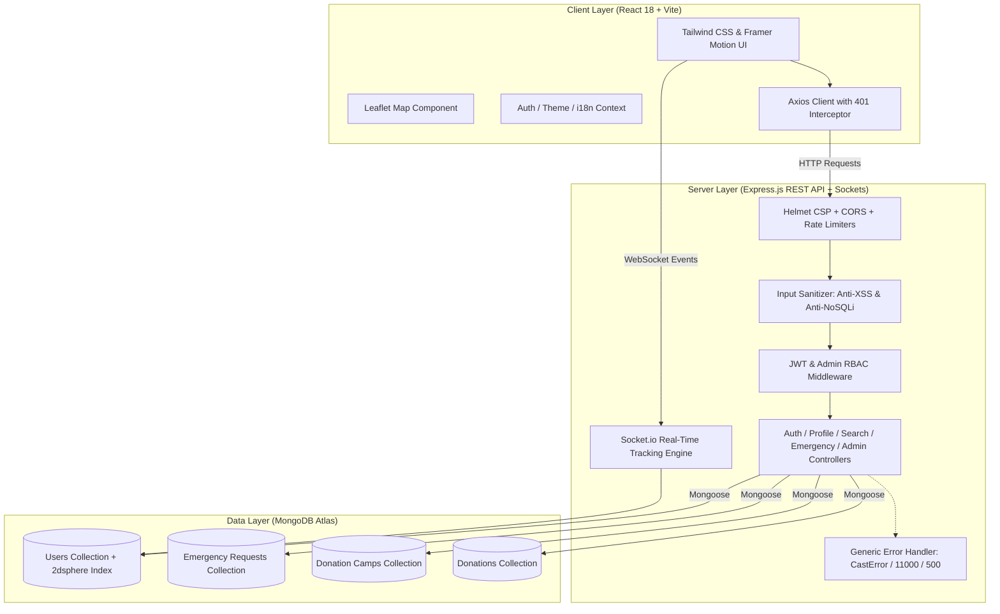

# 🩸 BloodOcean

<p align="center">
  
</p>

<h3 align="center">Lifesaving Emergency Blood Donation & Real-Time Geolocation Platform</h3>

<p align="center">
  <b>Connecting emergency blood seekers with verified nearby donors in real-time.</b>
</p>

<p align="center">
  <a href="https://bloodocean.vercel.app"></a>
  
  
  
  
  
</p>

---

## 📌 Links & Resources

- 🌐 **Live Web Application:** [https://bloodocean.vercel.app](https://bloodocean.vercel.app)
- 📖 **API Documentation:** [API_DOCUMENTATION.md](./API_DOCUMENTATION.md)
- 🚀 **Deployment Guide:** [DEPLOYMENT.md](./DEPLOYMENT.md)
- 📋 **Project Context & Architecture:** [PROJECT_CONTEXT.md](./PROJECT_CONTEXT.md)

---

## 📖 Overview

**BloodOcean** is a full-stack, responsive web application engineered to bridge the critical gap between blood donors and patients requiring emergency blood transfusions. By utilizing high-precision geospatial indexing (`2dsphere` on MongoDB Atlas) and the native browser Geolocation API, BloodOcean enables real-time proximity-based donor matching, emergency request broadcasting, interactive map navigation, live tracking, and blood camp management.

The application has been audited and hardened according to **OWASP Top 10** guidelines with a 23-test automated unit and integration security suite.

---

## ✨ Key Features

### 📍 Proximity-Based Donor Search
- **Haversine Proximity Search:** Find compatible donors within configurable radii (5 km, 10 km, 20 km, 50 km).
- **Geospatial Indexing:** Driven by MongoDB `GeoJSON Point` data and `$nearSphere` queries for ultra-fast location matching.
- **Filter by Compatibility:** Instant filtering by exact blood group compatibility (`A+`, `A-`, `B+`, `B-`, `AB+`, `AB-`, `O+`, `O-`) and availability status.
- **Scraping Protection:** Dedicated rate limiting prevents automated scraping of donor contact details.

### 🚨 Emergency Request Broadcast
- **Create Urgent Requests:** Post emergency blood requirements with patient details, hospital location, required blood units, and contact information.
- **Request Lifecycle Management:** Track request state dynamically (`Active`, `Fulfilled`, `Cancelled`).
- **Interactive Emergency Maps:** Pinpoint request locations on interactive Leaflet maps with live navigation links.

### 🗺️ Live Tracking & Interactive Maps
- **Leaflet & OpenStreetMap Integration:** Visual map view of active emergency requests, nearby available donors, and blood camps.
- **Real-Time Tracking:** Live route visualization and proximity updates between donor and recipient via WebSockets.
- **Coordinate Bounds Validation:** Strict numerical validation of GPS coordinates prevents malicious location spoofing.

### 🏥 Blood Donation Camps
- **Camp Discovery:** Find upcoming community blood donation drives and camps nearby.
- **Camp Location Maps:** Interactive map markers detailing camp schedules, venue addresses, and organizers.

### 🏆 Donation History & Achievements
- **Track Impact:** Record past blood donations, calculate lives saved, and track donation frequency.
- **Achievement Badges:** Unlock gamified milestones and donor badges for continuous community contributions.

### 🔔 Real-Time Notifications
- **Instant Alerts:** WebSockets (Socket.io) pipeline alerting nearby compatible donors when an emergency request is created.
- **In-App Notification Center:** Unread badge counts, quick mark-as-read, and detailed request action buttons.

### 🌐 Multi-Language (i18n) & Dark Mode UI
- **Internationalization:** Multi-language support (English, Hindi, and regional languages) managed via React Context.
- **Theme Switching:** Sleek dark mode and high-contrast light mode with Tailwind CSS.
- **Animated Splash Screen & Loaders:** Smooth UI animations powered by GSAP and Framer Motion.

### 🛡️ Admin Dashboard & Governance
- **Platform Analytics:** Real-time metrics on total donors, blood group distribution, active emergency requests, and fulfilled cases.
- **User & Request Control:** Manage profiles, remove non-compliant accounts, and monitor network health.
- **Strict Role-Based Access (RBAC):** Multi-tier authorization checks in frontend route guards, UI rendering, and Express middleware.

---

## 🔒 Security Architecture & Hardening

BloodOcean incorporates defense-in-depth security measures verified through automated testing:

| Security Domain | Implementation | Defense Mechanism |
| :--- | :--- | :--- |
| **Authentication** | JWT (`jsonwebtoken`) + `bcryptjs` | 12-round salt hashing; timing-safe SHA-256 OTP tokens with 15-min expiry; `select: false` on password field. |
| **Authorization (BOLA / IDOR)** | User-level ownership checks | Strict verification preventing users from viewing, modifying, or deleting other donors' requests, donations, or profiles. |
| **Admin Route Protection** | Layered RBAC guard | `protect` + `admin` Express middleware; `ProtectedRoute adminOnly` client redirection; role escalation blocked in registration and profile updates. |
| **Injection Defense** | Sanitization Middleware (`sanitize.js`) | Recursively strips MongoDB operator keys (`$`), dot notation (`.`), prototype pollution (`__proto__`, `constructor`), and object injection on avatar/image. |
| **XSS Defense** | Multi-Layer Filtering | Strips `<script>...</script>`, `<style>...</style>`, HTML tags, `javascript:`, `vbscript:`, and inline `on*` event handlers. React JSX output auto-escaping. |
| **Rate Limiting** | `express-rate-limit` | Multi-tier rate limiting: Auth brute-force protection (10 req/15 min), donor search anti-scraping (40 req/1 min), request creation anti-spam (20 req/15 min), and global API limiter (300 req/15 min). |
| **Security Headers** | `helmet` | Content-Security-Policy (CSP), `X-Frame-Options: DENY`, `X-Content-Type-Options: nosniff`, HSTS with preload (`max-age=31536000`), and `Permissions-Policy`. |
| **CORS Policy** | Origin Whitelist | Strictly validates incoming origins against configured frontend URLs in development and production. |
| **Information Disclosure** | Generic Error Handler | Suppresses database internals and stack traces; converts `CastError` (malformed ObjectIDs) and duplicate keys (`11000`) into safe `400 Bad Request` messages. |
| **Secrets Protection** | Environment Validation | Disallows default/insecure JWT secrets; strict `.gitignore` rules prevent committing `.env`, certificates, or private keys. |

---

## 🧪 Automated Testing

BloodOcean includes a test suite covering input sanitization, security headers, role authorization, rate limiting, and password hashing:

```bash
# Run server test suite
cd server
npm test
```

```text
PASS __tests__/auth_and_security.test.js
PASS __tests__/sanitize.test.js

Test Suites: 2 passed, 2 total
Tests:       23 passed, 23 total
Snapshots:   0 total
Time:        2.168 s
```

---

## 🛠️ Tech Stack

### **Frontend**
| Technology | Description |
| :--- | :--- |
| **React 18** | UI framework with Hooks and Context API |
| **Vite** | Next-generation frontend build tool (sourcemaps disabled in production) |
| **Tailwind CSS 3** | Utility-first CSS styling framework |
| **Leaflet & React-Leaflet** | Interactive vector map rendering & markers |
| **Framer Motion & GSAP** | High-performance visual UI animations |
| **Lucide React** | Modern icon set |
| **Axios** | HTTP client with automatic 401 token expiration interceptor |

### **Backend**
| Technology | Description |
| :--- | :--- |
| **Node.js** | Server-side JavaScript runtime |
| **Express.js** | Lightweight Web API framework |
| **MongoDB Atlas** | Cloud NoSQL database with geospatial `2dsphere` index |
| **Mongoose** | Elegant object modeling for MongoDB |
| **JWT & BcryptJS** | Secure stateless authentication & password hashing |
| **Socket.io** | WebSockets engine for real-time tracking with coordinate bounds validation |
| **Helmet & CORS** | Content Security Policy & HTTP security headers |
| **Express Rate Limit** | Multi-tier rate limiting and brute-force protection |
| **Nodemailer** | Transactional email delivery with TLS verification |
| **Jest & Supertest** | Automated unit & integration testing framework |

---

## 🏗️ System Architecture



---

## 📁 Project Directory Structure

```
BloodOcean/
├── client/                     # React + Vite Frontend
│   ├── public/                 # Static assets, favicon, audio
│   ├── src/
│   │   ├── api/               # Axios API configuration & interceptors
│   │   ├── components/        # Navbar, ProtectedRoute, SplashScreen, MagicLoader
│   │   ├── context/           # AuthContext, ThemeContext, LanguageContext
│   │   ├── hooks/             # Custom hooks (useLocationTracker, useTrackingSocket)
│   │   ├── i18n/              # Translation resources (English, Hindi)
│   │   ├── pages/             # Page Views (AdminDashboard, EmergencyRequests, Search, etc.)
│   │   ├── App.jsx            # Application Routing & Protected Routes
│   │   ├── index.css          # Tailwind CSS directives & global themes
│   │   └── main.jsx           # React DOM entry point
│   ├── package.json
│   └── vite.config.js
│
├── server/                     # Express.js Backend API
│   ├── __tests__/             # Automated Security Test Suite (Jest + Supertest)
│   │   ├── auth_and_security.test.js
│   │   └── sanitize.test.js
│   ├── config/                # Database (db.js) & Security config (security.js)
│   ├── controllers/           # Business logic (auth, profile, search, emergency, admin, etc.)
│   ├── middleware/            # Auth, Admin, Sanitize, Validation middleware
│   ├── models/                # Mongoose schemas (User, EmergencyRequest, Camp, Donation)
│   ├── routes/                # Express API routes
│   ├── scripts/               # Helper scripts (free-port.js)
│   ├── sockets/               # Socket.io live tracking handlers (tracking.js)
│   ├── utils/                 # sendEmail.js, sendError.js, formatUser.js
│   ├── .env.example           # Environment template (NO secrets)
│   ├── package.json
│   └── server.js              # Entry point & Express server bootstrap
│
├── API_DOCUMENTATION.md        # Comprehensive REST API reference
├── DEPLOYMENT.md               # Production deployment step-by-step guide
├── PROJECT_CONTEXT.md          # Architecture & data schema specifications
├── render.yaml                 # Render backend deployment manifest
├── vercel.json                 # Vercel SPA routing & security headers
└── README.md                   # Project README
```

---

## ⚡ Quick Start Guide

### Prerequisites
- **Node.js**: `v18.x` or higher installed
- **npm**: `v8.x` or higher installed
- **MongoDB Atlas**: An active cluster connection string (or local MongoDB v5+)

---

### 1. Clone Repository

```bash
git clone https://github.com/PranavSharma1008/BloodOcean.git
cd BloodOcean
```

---

### 2. Backend Setup

1. **Navigate to server directory:**
   ```bash
   cd server
   ```

2. **Install dependencies:**
   ```bash
   npm install
   ```

3. **Configure Environment Variables:**
   Copy the `.env.example` file to `.env`:
   ```bash
   cp .env.example .env
   ```

   Fill in your parameters inside `server/.env` (never commit this file):
   ```env
   PORT=5000
   MONGODB_URI=mongodb+srv://<username>:<password>@cluster.mongodb.net/bloodocean?retryWrites=true&w=majority
   JWT_SECRET=replace_with_a_random_32_plus_character_secret
   JWT_EXPIRE=7d
   NODE_ENV=development
   FRONTEND_URL=http://localhost:3000
   ```

4. **Run Security & Unit Tests:**
   ```bash
   npm test
   ```

5. **Start the backend development server:**
   ```bash
   npm run dev
   ```
   > The Express server runs at `http://localhost:5000`.

---

### 3. Frontend Setup

1. **Open a new terminal and navigate to client directory:**
   ```bash
   cd client
   ```

2. **Install dependencies:**
   ```bash
   npm install
   ```

3. **Configure Frontend Environment:**
   Create a `.env` file inside `client/` (leave blank for local Vite proxy to `/api`):
   ```env
   VITE_API_URL=
   ```

4. **Start Vite development server:**
   ```bash
   npm run dev
   ```
   > The React app will run at `http://localhost:3000`.

---

## 🔑 Environment Variables Reference

### **Server Environment (`server/.env`)**

| Variable | Description | Required | Default / Note |
| :--- | :--- | :---: | :--- |
| `PORT` | HTTP Server Port | Yes | `5000` |
| `MONGODB_URI` | MongoDB Atlas Connection String | Yes | Cloud connection URI |
| `JWT_SECRET` | Secret key for signing authentication tokens | Yes | Must be >= 32 characters in production |
| `JWT_EXPIRE` | Expiration lifespan of JWT token | No | `7d` |
| `NODE_ENV` | Environment mode (`development` / `production`) | No | `development` |
| `FRONTEND_URL` | Allowed CORS origin (comma-separated for multiples) | Yes (prod) | `http://localhost:3000` |
| `EMAIL_SERVICE` | Email provider (`SendGrid`, `Gmail`, `Resend`) | For resets | `SendGrid` recommended |
| `EMAIL_HOST` | Custom SMTP host | Optional | `smtp.sendgrid.net` |
| `EMAIL_PORT` | Custom SMTP port | Optional | `587` |
| `EMAIL_USER` | SMTP username | Optional | `apikey` |
| `EMAIL_PASS` | SMTP password / API key | Optional | SendGrid API key |
| `EMAIL_FROM` | Verified sender email | Optional | `noreply@yourdomain.com` |

> [!IMPORTANT]
> Never commit `.env` files to source control. BloodOcean `.gitignore` rules ensure all `.env` files, certificates, and credentials are kept strictly local.

---

## 📡 API Endpoint Overview

All API endpoints are prefixed with `/api`. For full request/response schemas, see [API_DOCUMENTATION.md](./API_DOCUMENTATION.md).

| Category | Method | Endpoint | Access | Description |
| :--- | :---: | :--- | :---: | :--- |
| **Auth** | `POST` | `/api/auth/register` | Public | Register new user account (rate-limited) |
| **Auth** | `POST` | `/api/auth/login` | Public | Login & receive JWT (rate-limited) |
| **Auth** | `POST` | `/api/auth/forgot-password` | Public | Request 6-digit password reset OTP |
| **Auth** | `POST` | `/api/auth/reset-password` | Public | Reset password using OTP token |
| **Auth** | `GET` | `/api/auth/me` | Private | Get authenticated user info |
| **Profile** | `GET` | `/api/profile` | Private | Get detailed user profile |
| **Profile** | `PUT` | `/api/profile` | Private | Update profile & donor status |
| **Profile** | `PUT` | `/api/profile/avatar` | Private | Upload base64 profile avatar |
| **Location**| `PUT` | `/api/location` | Private | Update GeoJSON coordinates |
| **Search** | `GET` | `/api/donors/nearby` | Private | Geospatial search by radius & blood group (rate-limited) |
| **Emergency**| `POST` | `/api/emergency` | Private | Create emergency blood request (rate-limited) |
| **Emergency**| `GET` | `/api/emergency` | Private | Fetch active emergency requests |
| **Emergency**| `PUT` | `/api/emergency/:id` | Private | Update request status (`fulfilled`/`cancelled`) |
| **Camps** | `GET` | `/api/camps` | Private | Get list of blood donation camps |
| **Camps** | `POST` | `/api/camps` | Private | Create a blood camp drive (rate-limited) |
| **Admin** | `GET` | `/api/admin/statistics` | Admin | Fetch system analytics & metrics |
| **Admin** | `GET` | `/api/admin/users` | Admin | Manage & view all platform users |

---

## 🚀 Deployment

BloodOcean is configured for seamless zero-downtime continuous deployment:

- **Backend API:** Configured for [Render](https://render.com) using [`render.yaml`](./render.yaml).
- **Frontend App:** Optimized for production deployment on [Vercel](https://vercel.com) using [`vercel.json`](./vercel.json).

For step-by-step production deployment instructions, check out [DEPLOYMENT.md](./DEPLOYMENT.md).

---

## 📄 License

Distributed under the **ISC License**. See `LICENSE` for details.

---

<p align="center">
  Crafted with ❤️ for saving lives.
</p>
